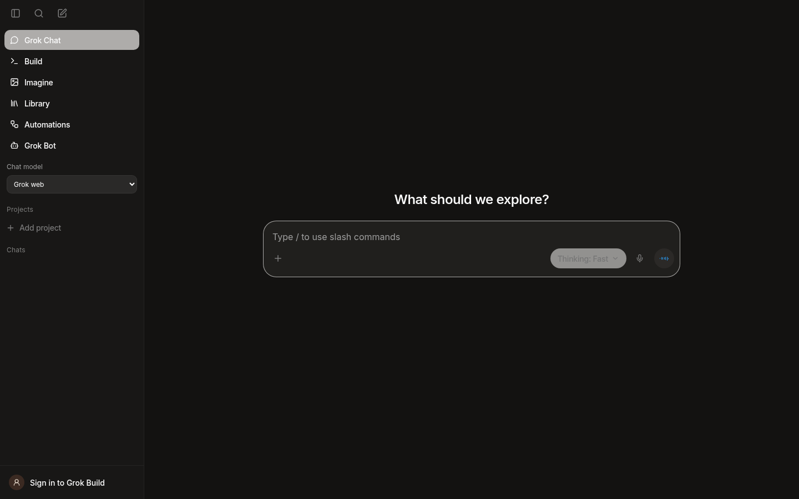
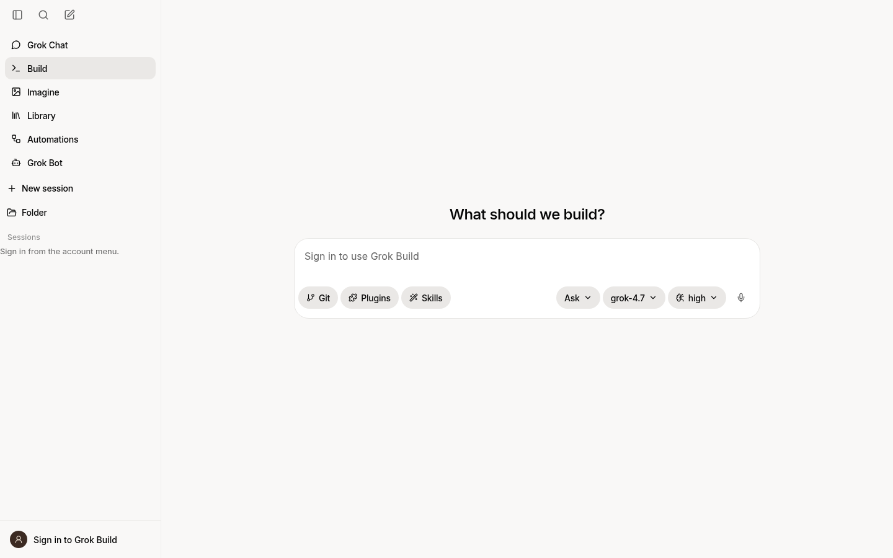
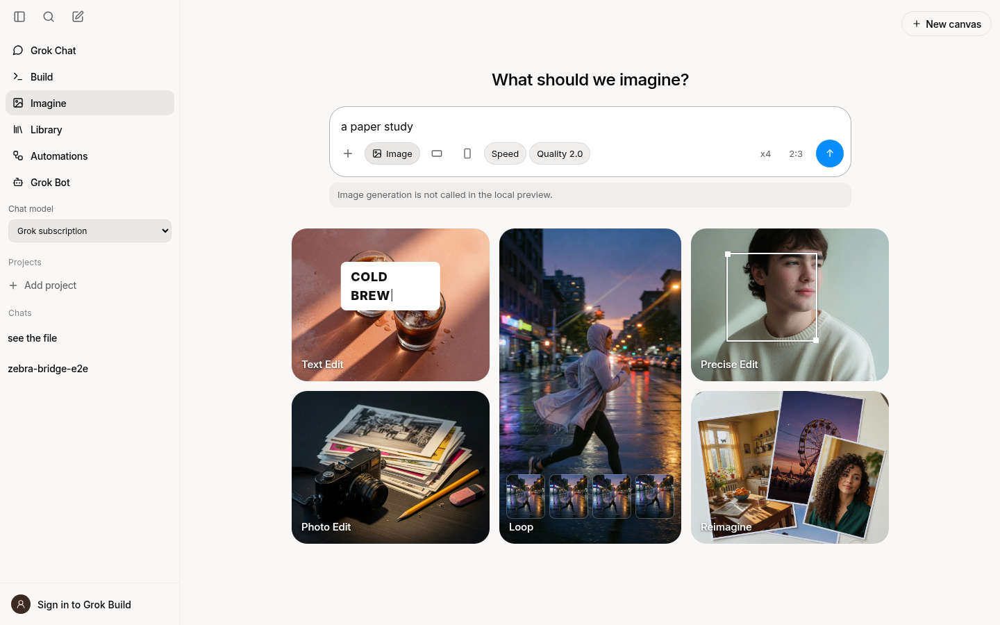

# GrokDeck

**Created by OSINTCabal**

Version **1.0.0**.

A Grok desktop app for **Fedora and Debian Linux**. Chat with Grok, work on code through the Grok CLI, and keep your projects in one window. GrokDeck is part of my desktop app series alongside VibeDeck.

[Install](docs/INSTALL.md) · [Development](docs/DEVELOPMENT.md) · [Verification](docs/VERIFICATION.md)



## Features

Grok Chat opens the official Grok website inside the desktop app. Choose a connected provider in the model selector to use GrokDeck's local chat instead, with streamed replies, a separate thinking selector, and saved conversations. Send a local chat prompt to Build when it needs code changes.

Build runs the Grok CLI in Ask, Plan, Accept edits, or Full auto mode. Pick a model and thinking level, review tool approvals, and return to saved coding sessions. The desktop also has local projects, search, attachments, voice, image tools, themes, and export.

## How it works

1. **Grok web chat:** The embedded Grok page saves its browser session across launches. Conversations in that page use your Grok account.
2. **Desktop and CLI:** Build talks to the Grok CLI through its agent protocol. Sign in to the CLI separately to use its subscription. Build can work in a local project directory.
3. **Providers and agents:** Add models in Settings, then choose a main model or ask it to use subagents. API keys stay in your desktop keyring. Local chats stay on this computer unless you send a prompt or attachment to a provider.

## Providers

| Provider | Connection |
| --- | --- |
| Grok | Grok CLI sign-in or xAI API key |
| Codex / ChatGPT | Official Codex CLI sign-in |
| Mistral AI | API key |
| OpenAI | API key |
| Claude | Anthropic API key |
| DeepSeek | API key |
| Z.ai | API key |
| MiniMax | Token Plan or API key |
| Google AI Studio | Gemini API key |
| Ollama | Local endpoint |

Add custom providers in **Settings → Providers** with a base URL, model ID, and optional API key. OpenAI Chat Completions and Anthropic Messages endpoints are supported. Model features and billing depend on the provider.

## Subagents

Choose **Settings → Providers → Subagents** to run workers when requested, automatically for longer tasks, or not at all. Set the worker quality and limit there.

Ask “Use DeepSeek and Z.ai subagents with strong models and high thinking.” Workers make bounded calls to configured providers and return reports for the main model to review. They receive the prompt and context you send; they cannot open local files or run tools. Up to three workers can run for one request in desktop Chat or before a Build turn.

## Installation

Fedora and Debian use **one repository and the same Electron installer**. Follow the [installation guide](docs/INSTALL.md) for system packages and the optional Grok CLI, then run:

```bash
bash packaging/install.sh
grokdeck
```

The installer adds a user-level launcher and preserves local data during updates. The Grok CLI is optional for web chat and API providers, and required for Build. RPM, DEB, and AppImage packages are experimental Electron-only builds; use the source installer for the complete app.

## Screenshots

Build:



Image workspace:



Screenshots use an isolated sample workspace. See [more screenshots](docs/shots).

## Notes

- The app uses XWayland on Linux for reliable frameless window movement and resizing under GNOME. It remembers your window size and position.
- Grok web sign-in is separate from Grok CLI sign-in and provider API keys. Signing out of one does not silently remove the others.
- Grok CLI subscription Chat accepts text and text-file attachments. For image attachments, use Grok web chat or an xAI API key.
- Google may block sign-in inside an embedded desktop browser. The Grok CLI browser sign-in is separate and still works for Build and desktop chat; the app cannot copy a Chrome session into Grok web.
- GrokDeck is unofficial and is not affiliated with xAI.

## Coming soon

More desktop features and deeper Grok integration are planned. The official Grok page already opens inside GrokDeck; Build uses the Grok CLI.
